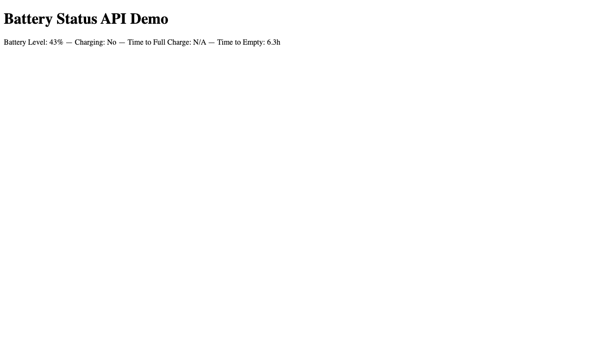

# WebSharper Battery Status API Binding

[](https://www.nuget.org/packages/WebSharper.BatteryStatus)

This repository provides an F# [WebSharper](https://websharper.com/) binding for the [Battery Status API](https://developer.mozilla.org/en-US/docs/Web/API/Battery_Status_API), exposing battery charge level, charging state, and estimated charge/discharge times to WebSharper applications.

> **Browser support:** The Battery Status API is implemented in Chromium-based browsers. Some browsers restrict or remove it for privacy reasons — check [MDN](https://developer.mozilla.org/en-US/docs/Web/API/Battery_Status_API) for the current compatibility matrix before relying on it in production.

## Repository structure

The repository contains three projects:

| Project | What it is |
| --- | --- |
| `WebSharper.BatteryStatus` | The WIG binding (`BatteryManager` class definition and extension registration). |
| `WebSharper.BatteryStatus.Extensions` | Hand-written `[<Inline>]` code — currently the `Navigator.GetBattery()` extension method. |
| `WebSharper.BatteryStatus.Sample` | An ASP.NET Core SPA that exercises the binding end to end. See [Running the test case](#running-the-test-case). |

## Live demos

**Try it live:** [Open the sample in your browser](https://dotnet-websharper.github.io/BatteryStatusAPI/)



The sample doubles as the binding's [test case](#running-the-test-case): it reads the current battery state and reacts to change events.

- Binding sample (GitHub Pages): <https://dotnet-websharper.github.io/BatteryStatusAPI/>
- Source: <https://github.com/dotnet-websharper/BatteryStatusAPI>
- WebSharper bindings catalog: <https://websharper.com/bindings>

## Installation

```bash
dotnet add package WebSharper.BatteryStatus
```

## Usage

The binding surfaces the API as regular .NET types. `Navigator.GetBattery()` returns a `Promise<BatteryManager>`; the manager exposes `Level`, `Charging`, `ChargingTime`, and `DischargingTime`, plus the `on*` change events (`OnChargingChange`, `OnChargingTimeChange`, `OnDischargingTimeChange`, `OnLevelChange`) and the inherited `AddEventListener`.

A condensed version of the sample, which binds the battery summary to a reactive `Var`:

```fsharp
namespace WebSharper.BatteryStatus.Sample

open WebSharper
open WebSharper.JavaScript
open WebSharper.UI
open WebSharper.UI.Client
open WebSharper.UI.Templating
open WebSharper.BatteryStatus

[<JavaScript>]
module Client =
    type IndexTemplate = Template<"wwwroot/index.html", ClientLoad.FromDocument>

    let batteryStatus = Var.Create "Checking battery status..."

    /// Formats a duration in seconds as minutes/hours, or "N/A" when the value is
    /// not finite (the API reports Infinity when the estimate does not apply).
    let formatDuration (seconds: float) =
        if seconds > 0.0 && seconds < 1e12 then
            let minutes = seconds / 60.0
            if minutes >= 60.0 then sprintf "%.1fh" (minutes / 60.0)
            else sprintf "%.0fm" minutes
        else "N/A"

    let updateBatteryInfo (battery: BatteryManager) =
        let chargingText = if battery.Charging then "Yes ⚡" else "No"
        batteryStatus.Value <-
            sprintf "Battery Level: %d%% — Charging: %s — Time to Full Charge: %s — Time to Empty: %s"
                (int (battery.Level * 100.0))
                chargingText
                (formatDuration battery.ChargingTime)
                (formatDuration battery.DischargingTime)

    let initializeBattery () =
        try
            JS.Window.Navigator.GetBattery().Then(fun (battery: BatteryManager) ->
                updateBatteryInfo battery

                battery.AddEventListener("levelchange", fun (_: Dom.Event) -> updateBatteryInfo battery)
                battery.AddEventListener("chargingchange", fun (_: Dom.Event) -> updateBatteryInfo battery)
                battery.AddEventListener("chargingtimechange", fun (_: Dom.Event) -> updateBatteryInfo battery)
                battery.AddEventListener("dischargingtimechange", fun (_: Dom.Event) -> updateBatteryInfo battery)
            )
            |> ignore
        with error ->
            batteryStatus.Value <- error.Message

    [<SPAEntryPoint>]
    let Main () =
        initializeBattery()

        IndexTemplate.Main()
            .BatteryStatus(batteryStatus.V)
            .Doc()
        |> Doc.RunById "main"
```

## Running the test case

The sample doubles as the repository's test case. It covers:

- calling `Navigator.GetBattery()` and reading the resolved `BatteryManager`;
- rendering `Level`, `Charging`, `ChargingTime`, and `DischargingTime` through a reactive `Var`;
- refreshing the display on each of the four `*change` events via `AddEventListener`.

Build and run it:

```bash
cd WebSharper.BatteryStatus.Sample
dotnet run
```

Then open the URL printed in the console. The page shows the current battery summary and updates when the charge state changes. Note that some browsers (notably Safari and Firefox) do not implement the API; the sample reports the failure in the status line.

## Building from source

Prerequisites: [.NET SDK](https://dotnet.microsoft.com/download) 10.0 or later.

```bash
git clone https://github.com/dotnet-websharper/BatteryStatusAPI.git
cd BatteryStatusAPI
dotnet build WebSharper.BatteryStatus/WebSharper.BatteryStatus.fsproj
dotnet build WebSharper.BatteryStatus.Sample/WebSharper.BatteryStatus.Sample.fsproj
```

## Deployment

`.github/workflows/ghpages.yml` builds the sample in Release on every push to `main` and publishes `WebSharper.BatteryStatus.Sample/wwwroot` to GitHub Pages.

## License

Apache 2.0 — see the [WebSharper core repository](https://github.com/dotnet-websharper/core/blob/master/LICENSE.md).
